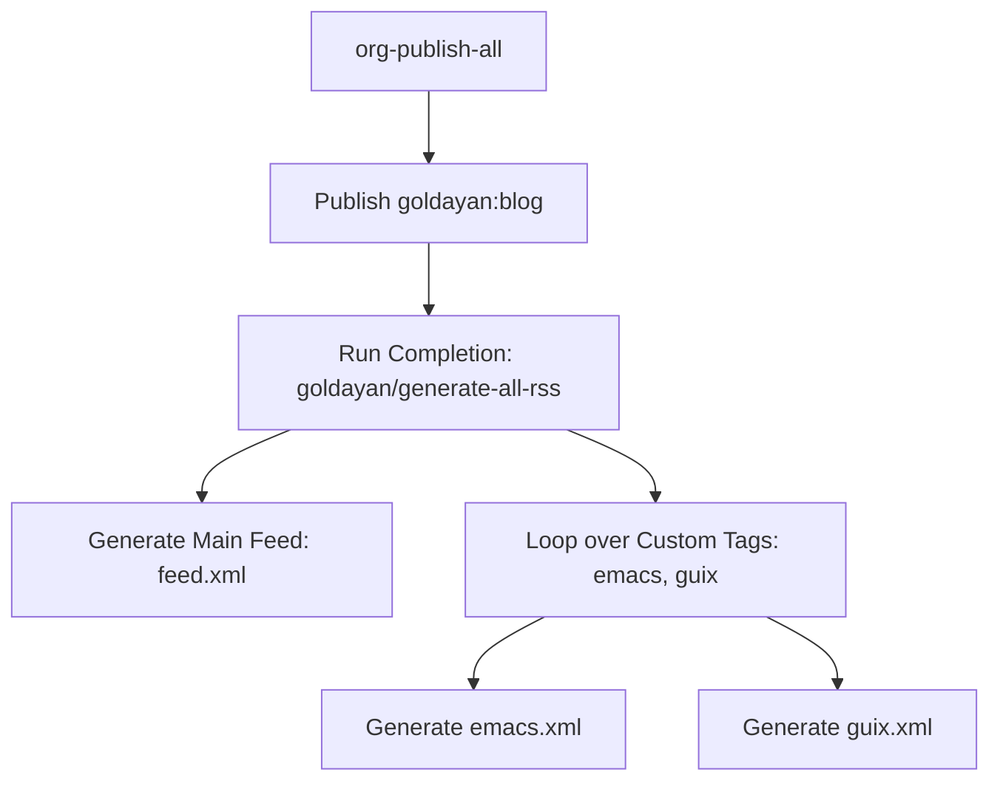

# Walkthrough: How Org-Publish and RSS Generation Works

This document explains the inner workings of Org's publishing framework (`ox-publish`), how `org-publish-rss` integrates with it, and how we configured a custom build system in `build-site.el` to support draft filtering and tag-specific RSS feeds.

---

## 1. How Org-Publish Works

Org Mode includes a built-in static site generator called **ox-publish**. It is controlled by the variable `org-publish-project-alist`, which maps project names to their configuration plists (property lists).

### The Publishing Lifecycle
When you call `(org-publish-all t)` or run Emacs in script mode, the following steps occur:

1. **Scan Source Directory**: Org scans the `:base-directory` for files matching `:base-extension` (e.g., `"org"`).
2. **Compare Timestamps**: Org maintains a cache database (usually in `~/.org-timestamps/`). It checks the modification times of source files. If a source file has not changed since the last build, it is skipped unless a forced rebuild is requested (`org-publish-all t`).
3. **Run Publishing Function**: For each modified file, Org executes the `:publishing-function` (such as `org-html-publish-to-html` or `org-publish-attachment`). This compiles the Org file into HTML in the `:publishing-directory`.
4. **Run Completion Function**: Once all files in a project have finished compiling, Org executes the `:completion-function` (if defined), passing the project configuration. This is where RSS feed generation hooks in.

---

## 2. Integrating `org-publish-rss`

Historically, generating RSS feeds in Org static sites involved:
- **`ox-rss.el`**: Exported a single monolithic Org file into an RSS feed.
- **`webfeeder`**: Scanned compiled HTML files on disk to build a feed (requires reading compiled output).

The `org-publish-rss` extension runs during the completion step of `org-publish`. It reads the project metadata and source Org files directly to generate standard RSS 2.0 feeds.

### Custom Configuration Properties
`org-publish-rss` adds new configuration properties to `org-publish-project-alist`:
- `:auto-rss t`: Enables RSS generation.
- `:rss-file "feed.xml"`: Overrides the default `rss.xml` filename.
- `:rss-title` & `:rss-description`: Sets the feed channel metadata.
- `:rss-with-content all`: Places the full body of the exported HTML posts inside `<description>` blocks (making them readable in feed clients).
- `:rss-filter-function`: A callback predicate that determines if a file should be included in the feed.

---

## 3. Implementing Draft Filtering and Tag Sub-Feeds

To support `#+draft: true` and `#+tags: tag1, tag2` within Org frontmatter, we implemented lightweight metadata extractors and a custom completion handler in [build-site.el](file:///home/goldayan/CodePARA/01_Projects/OrgPublish/my-org-blog/build-site.el).



### Performance-First Frontmatter Parsing
Instead of initializing a heavy Org-mode major buffer for every file (which triggers slow mode hooks and formatting), we read keywords directly using `with-temp-buffer` and fast regex scanning:

```elisp
(defun goldayan/get-org-keyword (file keyword)
  (with-temp-buffer
    (insert-file-contents file)
    (goto-char (point-min))
    (let ((case-fold-search t))
      (when (re-search-forward (format "^#\\+%s:[ \t]*\\(.*\\)$" (regexp-quote keyword)) nil t)
        (string-trim (match-string 1))))))
```

This allows us to evaluate drafts and tags extremely quickly:
- **Drafts**: Evaluates to true if `#+draft:` is set to `"true"`, `"t"`, `"yes"`, or `"1"`.
- **Tags**: Supports both comma-separated (`#+tags: emacs, guix`) and colon-separated (`#+filetags: :emacs:guix:`) lists.

### The Custom Feed Builder: `goldayan/generate-all-rss`
Instead of creating dummy entries in `org-publish-project-alist` (which would trigger redundant file scanning and cache resets), we dynamically build temporary project plists on-the-fly and pass them straight to `org-publish-rss`.

```elisp
(defun goldayan/generate-all-rss (project)
  ;; 1. Generate the main feed (feed.xml)
  (org-publish-rss project)

  ;; 2. Generate tag-specific feeds
  (let ((base-plist (cond ((stringp project)
                           (cdr (assoc project org-publish-project-alist)))
                          ((stringp (car project))
                           (cdr project))
                          (t project)))
        (proj-name (cond ((stringp project) project)
                         ((stringp (car project)) (car project))
                         (t "project"))))
    (dolist (tag goldayan/rss-custom-tags)
      (let* ((filename (format "%s.xml" tag))
             (title (format "Gold Ayan's Tinker Garage - %s" (capitalize tag)))
             (desc (format "Blog posts tagged with %s" tag))
             ;; The lambda closure locks in the target tag
             (filter-fn (lambda (file)
                          (and (string-match-p "/posts/" file)
                               (not (string-equal (file-name-nondirectory file) "index.org"))
                               (not (goldayan/org-file-draft-p file))
                               (goldayan/org-file-has-tag-p file tag))))
             (tag-plist (copy-sequence base-plist)))
        (setq tag-plist (plist-put tag-plist :rss-file filename))
        (setq tag-plist (plist-put tag-plist :rss-title title))
        (setq tag-plist (plist-put tag-plist :rss-description desc))
        (setq tag-plist (plist-put tag-plist :rss-filter-function filter-fn))
        (let ((tag-project (cons proj-name tag-plist)))
          (org-publish-rss tag-project))))))
```

This guarantees:
- All generated feeds respect the `org-publish-rss-publish-immediately` setting and write directly to your `./public` folder.
- Custom tag filters only match published posts (under `/posts/`), exclude directory indexes (`index.org`), ignore drafts, and filter for tags dynamically.
